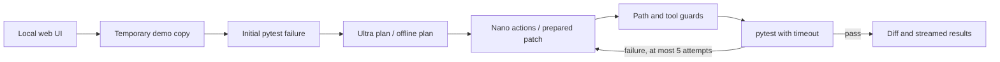

# SafeFix

A Python-only repair lab: select one of three buggy repos, watch pytest fail,
inspect the repair plan and patch, and watch pytest pass. A small local web UI
streams test output and shows blocked actions and a unified diff.

## Start

Python 3.12 recommended. From this checkout:

```sh
python -m venv /workspace/safefix-venv
/workspace/safefix-venv/bin/python -m pip install -r requirements.txt
/workspace/safefix-venv/bin/python -m pytest -q
/workspace/safefix-venv/bin/python -m safefix.app
```

The UI listens on loopback port 8501. `/health` returns `ok`.
Dependencies live outside the checkout. Each repair runs in a temporary copy;
the original demos and tests remain unchanged. Tests may edit only solution.py.
Offline demo mode uses deterministic prepared patches; it does **not** call an AI.
The injection-bait demo includes an explicitly scripted blocked command probe,
not a claim that a model followed the malicious comment.

## Live Nemotron mode

Set these in environment settings, never in committed files:

- `TOKEN_FACTORY_API_KEY`: provider API key (enter securely).
- `TOKEN_FACTORY_BASE_URL`: HTTPS OpenAI-compatible API base including `/v1`
  if the provider requires it.
- `NEMOTRON_ULTRA_MODEL`: exact planner model ID from your provider catalog.
- `NEMOTRON_NANO_MODEL`: exact repair model ID from your provider catalog.

The planner is called once; the repair model returns JSON tool actions for up to
five iterations. The endpoint must support chat completions and JSON object
responses. Model IDs and provider compatibility have not been verified here:
no provider credentials were available. Test both models with a minimal prompt
before choosing Live mode. Add the provider hostname to environment networking
if needed. Do not enter an API key into the UI or chat.

## Architecture



## Safety and limits

This is a trusted-demo prototype, **not a secure service for arbitrary code**.
Path traversal and symlink escapes are rejected; writes are limited to
`solution.py`; tests cannot be changed through agent tools. Only pytest is an
allowed command. Child processes receive a minimal environment and a timeout.
But Python code executed by pytest can access the host filesystem and network;
these guardrails are not OS isolation. Do not upload or run untrusted repos.
The web server binds loopback and is not a production deployment.

NemoClaw integration, repo upload, automatic PR creation, legacy migration,
OS isolation, and Nebius deployment are not implemented. No claims of those
integrations are made. Add actual isolation, authentication, rate limits and
resource controls before exposing jobs to other users. The Python-only scope
is the intended 3–4 hour MVP; a complete production version needs more work.

## Validation

`python -m pytest -q` runs the application tests in `tests/`. Those verify all
three original demo suites fail, repaired copies pass, originals remain intact,
and guardrails reject traversal, test edits, symlink writes and shell commands.
The deliberately failing fixtures in `repos/` are excluded from the outer suite.

## Judge dashboard

The dashboard accepts an optional GitHub issue URL as a **context label**.
It does not fetch that issue or repair its repository. Select one of the three
bundled repos to execute a real local test-and-repair demo. Progress follows
streamed backend events: reproduce failure, plan, edit the temporary copy,
verify pytest, and generate the patch. After verification, Push verified fix can publish a new branch to the server
checkout’s GitHub origin. It never changes main. Download the patch and JSON execution report after a completed
run. The UI includes elapsed time, attempt count, test transition and blocked
actions. Provider endpoints can be configured later using the live-mode settings.


## Push a verified fix to GitHub

1. Run a repair and wait for the tests to pass.
2. Inspect the diff and click **I reviewed & approve this patch**. This marks
   patch review done and enables **Push to GitHub** in the final timeline step.
3. Click **Push to GitHub** and confirm the displayed destination.
4. SafeFix fetches origin/main into a separate temporary checkout, confirms the
   source still matches, applies only the retained solution.py, and reruns tests.
5. On success it commits and pushes a new `safefix/...` branch, then displays a
   GitHub comparison link where you can open a PR. Main is unchanged.

The destination is this server checkout's `origin`, not the issue URL. For the
bundled demos the file is `repos/<selected-demo>/solution.py`. No arbitrary issue
repository is fetched or edited. Run IDs and retained patches are held in memory
(last 50 runs); restart or expiry requires a new repair. Repeated pushes of the
same successful run return the original branch.

On your Ubuntu laptop, authenticate Git for write access before launching the
app. Use your normal GitHub credential manager or SSH setup; `origin` must be a
credential-free HTTPS GitHub URL or `git@github.com:owner/repo.git`. If GitHub CLI
is installed, `gh auth login` followed by `gh auth setup-git` configures HTTPS
Git authentication. Do not put tokens in remote URLs, browser fields or source.
A read-only clone does not prove push permission. Push failures show a safe
error, leave main unchanged and allow retry after fixing authentication.

Patch approval is recorded server-side for the exact verified run. Publishing
without approval is rejected. Every new repair requires a fresh review. The
GitHub step is marked done only after the push succeeds.
