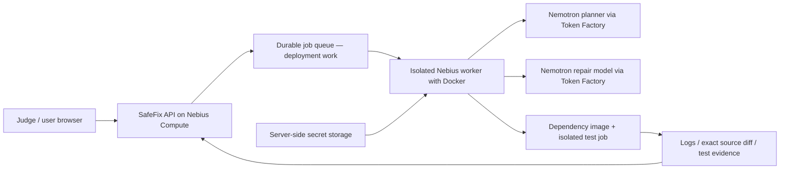

# Nebius-first SafeFix

SafeFix's production provider is **Nebius Token Factory**. Groq is an optional
compatibility/test profile, not the production model or deployment architecture.
No model ID is invented or silently substituted: choose IDs actually served by
your Token Factory account. No live Nebius call or Nebius deployment has been
verified without your account credentials.

## Backend configuration

Enter `TOKEN_FACTORY_API_KEY` securely in the server terminal or hosting secret
settings. Never add it to Git, frontend JavaScript, Docker build arguments or
repository test environments. In the same terminal:

```sh
export SAFEFIX_PROVIDER=nebius
export TOKEN_FACTORY_BASE_URL=https://api.tokenfactory.nebius.com/v1
export SAFEFIX_PLANNER_MODEL='EXACT_PLANNER_MODEL_ID_FROM_YOUR_CATALOG'
export SAFEFIX_REPAIR_MODEL='EXACT_REPAIR_MODEL_ID_FROM_YOUR_CATALOG'
unset SAFEFIX_INPUT_BYTES SAFEFIX_OUTPUT_TOKENS SAFEFIX_RUNNER_IMAGE
python -m safefix.check_provider
```

`check_provider` lists models via `/models` without requesting inference; it never
prints the key. Listing is not a guarantee that a particular model supports every
request parameter. Model IDs can also use the legacy `NEMOTRON_ULTRA_MODEL` and
`NEMOTRON_NANO_MODEL` variables. The new SAFEFIX role variables take precedence.
For the hackathon select Nemotron models if they are available in the account's
catalog; do not label an unrelated provider/model as Nemotron.

The default Nebius profile budgets **64KB message content / 6,000 output tokens**,
with a retrieval-based initial context up to 24KB. It supports continued source
searches, line reads, multi-file edits and new Python source files. Bounds remain
configurable through `SAFEFIX_INPUT_BYTES` (2KB–256KB) and
`SAFEFIX_OUTPUT_TOKENS` (512–16,384). Bytes are not exact tokenizer counts: select
limits within the actual model's context window and your account allowance.

Groq is selected explicitly with `SAFEFIX_PROVIDER=groq` or inferred from an
existing Groq base URL. Only that test profile defaults to 8KB / 1,500 tokens.
An explicit provider conflicting with another known provider's URL is rejected.
Changing keys alone does not switch endpoint, models or account permissions.

If a provider specifically rejects JSON response mode or reports
`json_validate_failed`, SafeFix retries once without provider-enforced JSON mode.
It still requests JSON text, parses it and validates the plan/tool actions before
using them. This compatibility retry does not switch models or providers.
Unrelated HTTP 400 errors, authentication failures and quota errors do not trigger
this retry. Errors show only recognized error codes/parameter names; raw provider
messages and failed generations are never logged. A successful `/models` listing
or small chat request does not guarantee a repository-planning request will work.

## Any public Python repository, not a benchmark allowlist

Prepare a repository by its identity:

```sh
python -m safefix.prepare_runner owner/repository
```

Unknown repository names are supported. The generic builder reads `pyproject.toml`,
`setup.cfg`, requirements files, package layout, test extras and Python constraints
without executing repository code on the host. Installation and package build
hooks run only inside Docker. It chooses a compatible supported Python version;
`--python 3.13` and `--project-dir packages/my_library` handle explicit choices
and monorepos. `--generic` forces the generic recipe for benchmark projects too.
The earlier three project recipes are retained only as optional build optimizations
and repeatable evaluation fixtures, not as eligibility checks in the repair engine.

For automatic environment preparation on an isolated worker:

```sh
export SAFEFIX_AUTO_PREPARE=1
python -m safefix.app
```

The app streams actual dependency-build output and checks the prepared image's
repository/commit labels. It then checks out that exact revision. The model key
is stripped from the environment-builder subprocess and never passed to Docker.
Existing prepared environments are reused for that revision. To refresh source,
rerun the preparation command or use a specific `--ref` commit.

The planner can list the repository, search symbols and inspect metadata before
returning a plan. Invalid JSON, missing fields, nonexistent test files and invalid
regression syntax produce distinct feedback and correction attempts. Existing
tests are not mandatory if a valid issue-specific regression can be generated.
Original tests and the generated regression freeze before source repair.

Repair discovery calls do not consume a tested-repair round or blindly rerun
pytest. Source edits trigger verification; the default budget is 16 Nebius model
steps and at most five tested rounds. `SAFEFIX_PLAN_STEPS`, `SAFEFIX_REPAIR_STEPS`
and `SAFEFIX_TEST_ROUNDS` configure those limits. Passing baselines, zero tests,
collection failures and environment errors are never represented as agent fixes.

## Nebius infrastructure boundary



The current implementation runs locally in a process with a streaming HTTP UI;
it has **not** deployed the queue, API or workers to Nebius. Token Factory serves
model inference; do not assume an inference serverless endpoint can host the
entire UI and Docker job execution service. A Nebius Compute worker can host the
Docker-based execution path; production hosting needs credentials, job persistence,
authentication, quotas, cancellation and deliberate worker isolation. None of
those should be represented as deployed integrations during the hackathon.

The source sandbox currently runs pytest (which also collects unittest suites).
Projects needing unavailable system packages, external databases, proprietary
credentials, unusual build tooling, other test runners or unsupported Python
versions can require a custom prepared image or adapter. This is an extensible
Python workflow, not a guarantee to solve every issue. Issue-mode GitHub publication
and NemoClaw integration are still unimplemented; reviewed patches are downloadable.
